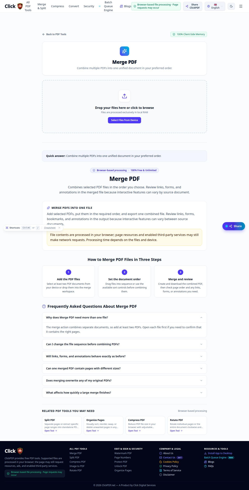
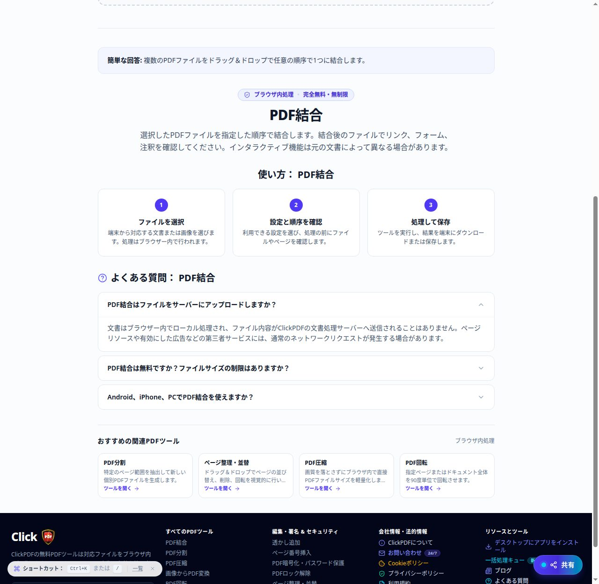

# ClickPDF Final Multilingual SEO Verification

**Date:** 2026-10-30
**Scope:** Read-only verification of the implemented SEO content and 21-language tool UI. No translations or application code were changed, and nothing was deployed.

## Verdict

The English SEO content is complete for all 21 public tools: 126 distinct FAQs and 63 tool-specific How-to steps. The shared tool-page UI strings are populated in all 21 supported languages.

The requested multilingual SEO work is **not complete**. In each non-English language, the rendered tool page has only three generic FAQs and three generic How-to steps, rather than the six FAQs and three tool-specific steps for that tool. The page's runtime FAQ/HowTo JSON-LD remains English and does not match the translated visible content. Tool URLs are not localized: representative `/ja/`, `/ur/`, and `/de/` tool paths return 404 in production. The current single canonical tool URL and sitemap are internally consistent, but there are no tool-page `hreflang` or `x-default` alternates.

## 1. Tool-by-tool content verification

Source checked: `src/data/toolPageContent.ts`, `src/data/toolSeoData.ts`, and the renderer in `src/components/ToolSeoContentSection.tsx`.

| Tool route | English unique FAQs | English unique How-to steps | Non-English visible copy per tool |
|---|---:|---:|---|
| `/tools/image-to-pdf/` | 6 | 3 | 3 generic FAQs; 3 generic steps |
| `/tools/merge-pdf/` | 6 | 3 | 3 generic FAQs; 3 generic steps |
| `/tools/split-pdf/` | 6 | 3 | 3 generic FAQs; 3 generic steps |
| `/tools/compress-pdf/` | 6 | 3 | 3 generic FAQs; 3 generic steps |
| `/tools/page-numbers-pdf/` | 6 | 3 | 3 generic FAQs; 3 generic steps |
| `/tools/pdf-to-image/` | 6 | 3 | 3 generic FAQs; 3 generic steps |
| `/tools/rotate-pdf/` | 6 | 3 | 3 generic FAQs; 3 generic steps |
| `/tools/edit-pdf-metadata/` | 6 | 3 | 3 generic FAQs; 3 generic steps |
| `/tools/organize-pdf/` | 6 | 3 | 3 generic FAQs; 3 generic steps |
| `/tools/watermark-pdf/` | 6 | 3 | 3 generic FAQs; 3 generic steps |
| `/tools/ocr-pdf-analysis/` | 6 | 3 | 3 generic FAQs; 3 generic steps |
| `/tools/unlock-pdf-password/` | 6 | 3 | 3 generic FAQs; 3 generic steps |
| `/tools/protect-pdf-password/` | 6 | 3 | 3 generic FAQs; 3 generic steps |
| `/tools/pdf-to-text/` | 6 | 3 | 3 generic FAQs; 3 generic steps |
| `/tools/pdf-to-word/` | 6 | 3 | 3 generic FAQs; 3 generic steps |
| `/tools/pdf-to-excel/` | 6 | 3 | 3 generic FAQs; 3 generic steps |
| `/tools/pdf-to-powerpoint/` | 6 | 3 | 3 generic FAQs; 3 generic steps |
| `/tools/word-to-pdf/` | 6 | 3 | 3 generic FAQs; 3 generic steps |
| `/tools/word-to-excel/` | 6 | 3 | 3 generic FAQs; 3 generic steps |
| `/tools/excel-to-pdf/` | 6 | 3 | 3 generic FAQs; 3 generic steps |
| `/tools/sign-pdf-online/` | 6 | 3 | 3 generic FAQs; 3 generic steps |
| **Total** | **126** | **63** | **1,260 generic FAQ entries and 1,260 generic step entries across 20 non-English locales** |

All 126 English FAQ questions are distinct. Each English tool has three steps, and all 21 English How-to sets are distinct. The non-English entries are not these translated tool-specific records: the component replaces them with the same three generic FAQ questions and three generic steps, with the translated tool name inserted where applicable.

## 2. Language-by-language rendered verification

The language selector was exercised in a browser for all 21 options on `/tools/merge-pdf/`. Each selection updated the document language and saved preference; the URL stayed `/tools/merge-pdf/`. The current language data contains 15 shared tool-page strings per locale. All 300 non-English shared strings differ from the English strings and the i18n coverage test passed.

| Code | Language | Shared strings | Visible FAQs per tool | Visible steps per tool | New tool-specific FAQs/steps translated |
|---|---|---:|---:|---:|---|
| `en` | English | 15/15 | 6/6 unique | 3/3 unique | English source |
| `ur` | Urdu | 15/15 | 3/6 generic | 3/3 generic | No |
| `hi` | Hindi | 15/15 | 3/6 generic | 3/3 generic | No |
| `ar` | Arabic | 15/15 | 3/6 generic | 3/3 generic | No |
| `fr` | French | 15/15 | 3/6 generic | 3/3 generic | No |
| `de` | German | 15/15 | 3/6 generic | 3/3 generic | No |
| `zh` | Simplified Chinese | 15/15 | 3/6 generic | 3/3 generic | No |
| `ja` | Japanese | 15/15 | 3/6 generic | 3/3 generic | No |
| `tl` | Filipino | 15/15 | 3/6 generic | 3/3 generic | No |
| `es` | Spanish | 15/15 | 3/6 generic | 3/3 generic | No |
| `it` | Italian | 15/15 | 3/6 generic | 3/3 generic | No |
| `no` | Norwegian | 15/15 | 3/6 generic | 3/3 generic | No |
| `ru` | Russian | 15/15 | 3/6 generic | 3/3 generic | No |
| `pt` | Portuguese | 15/15 | 3/6 generic | 3/3 generic | No |
| `ko` | Korean | 15/15 | 3/6 generic | 3/3 generic | No |
| `tr` | Turkish | 15/15 | 3/6 generic | 3/3 generic | No |
| `nl` | Dutch | 15/15 | 3/6 generic | 3/3 generic | No |
| `pl` | Polish | 15/15 | 3/6 generic | 3/3 generic | No |
| `sv` | Swedish | 15/15 | 3/6 generic | 3/3 generic | No |
| `id` | Indonesian | 15/15 | 3/6 generic | 3/3 generic | No |
| `vi` | Vietnamese | 15/15 | 3/6 generic | 3/3 generic | No |

**Coverage interpretation**

- Shared localized tool-page strings: **315/315 populated**; all 300 non-English strings differ from English.
- FAQ quantity on non-English pages: **3/6, or 50%**. The visible three are generic, not six unique FAQs for each tool.
- How-to quantity on non-English pages: **3/3, or 100% by count**, but the steps are generic rather than the tool-specific steps.
- The requested page-specific SEO content translated into non-English languages: **0/20 languages**. Across all locale/tool combinations, only the English source is complete: **126/2,646 FAQs (4.76%)** and **63/1,323 How-to steps (4.76%)**. Generic translated entries do not count as translations of those unique records.
- Complete tool-specific FAQ coverage: English **21/21 tools**; each non-English locale **0/21 tools**.

## 3. Structured data versus visible content

The static English HTML passes the structured-data checks: each of the 21 generated tool pages has six visible FAQs and three visible How-to steps matching its `FAQPage` and `HowTo` JSON-LD.

The runtime language-switch test found a mismatch in every selected locale on the representative Merge PDF page:

| Japanese rendered page check | Visible content | Runtime JSON-LD |
|---|---|---|
| FAQ count | 3 Japanese questions | 6 English questions |
| First FAQ | `PDF結合はファイルをサーバーにアップロードしますか？` | `Why does Merge PDF need more than one file?` |
| How-to count | 3 generic Japanese steps | 3 English tool-specific steps |
| First step | `ファイルを選択` | `Add the PDF files` |
| Document title | English title remains | English metadata |

The canonical stays `https://www.clickpdf.net/tools/merge-pdf/` after switching language. This mismatch follows the current implementation: the component switches visible FAQ/How-to copy for non-English languages, while tool JSON-LD is still built from the English SEO registry.

## 4. Routes, canonical, hreflang, and sitemap

### Production HTTP checks

All 21 canonical English tool URLs returned **HTTP 200**, with **zero redirects**, and each response's canonical link matched its URL exactly.

| Production route | Status | Redirects | Canonical |
|---|---:|---:|---|
| `/tools/image-to-pdf/` | 200 | 0 | Match |
| `/tools/merge-pdf/` | 200 | 0 | Match |
| `/tools/split-pdf/` | 200 | 0 | Match |
| `/tools/compress-pdf/` | 200 | 0 | Match |
| `/tools/page-numbers-pdf/` | 200 | 0 | Match |
| `/tools/pdf-to-image/` | 200 | 0 | Match |
| `/tools/rotate-pdf/` | 200 | 0 | Match |
| `/tools/edit-pdf-metadata/` | 200 | 0 | Match |
| `/tools/organize-pdf/` | 200 | 0 | Match |
| `/tools/watermark-pdf/` | 200 | 0 | Match |
| `/tools/ocr-pdf-analysis/` | 200 | 0 | Match |
| `/tools/unlock-pdf-password/` | 200 | 0 | Match |
| `/tools/protect-pdf-password/` | 200 | 0 | Match |
| `/tools/pdf-to-text/` | 200 | 0 | Match |
| `/tools/pdf-to-word/` | 200 | 0 | Match |
| `/tools/pdf-to-excel/` | 200 | 0 | Match |
| `/tools/pdf-to-powerpoint/` | 200 | 0 | Match |
| `/tools/word-to-pdf/` | 200 | 0 | Match |
| `/tools/word-to-excel/` | 200 | 0 | Match |
| `/tools/excel-to-pdf/` | 200 | 0 | Match |
| `/tools/sign-pdf-online/` | 200 | 0 | Match |

Representative localized path checks in production returned **HTTP 404**, with zero redirects:

| Route | Status |
|---|---:|
| `/ja/tools/merge-pdf/` | 404 |
| `/ur/tools/merge-pdf/` | 404 |
| `/de/tools/merge-pdf/` | 404 |

The source route parser recognizes `/tools/:slug`, but not a locale prefix. The language switcher changes client-side language state and local storage without changing the path. Therefore, a manually selected language is not represented by a localized tool URL.

### Canonical and alternate metadata

- Production tool pages: **21/21 canonical links match** their final `https://www.clickpdf.net/tools/{slug}/` URLs.
- Production tool pages: **0 hreflang alternate links** and no tool-page `x-default`, because there are no separate localized tool URLs.
- Live sitemap: valid XML with **262 URL entries**, including **21 canonical tool URLs**, zero duplicate locations, and zero tool-page locale alternates. Tool links use HTTPS, the canonical `www` host, and trailing slashes.
- The build's localized blog sitemap/head checks still pass for localized article routes, including their hreflang and `x-default` entries. This does not provide localized routes for PDF tools.

## 5. Screenshots

These screenshots are from the running local preview, not production. The translated capture shows the current Japanese generic 3-step/3-FAQ content.

### English Merge PDF page

### Japanese Merge PDF page

## 6. Build and test results

| Check | Result |
|---|---|
| `pnpm --filter @workspace/clickpdf run typecheck` | Passed |
| `pnpm --filter @workspace/clickpdf run build` | Passed; Vite built 2,585 modules |
| Build regression suite | **21/21 passed** |
| i18n + structured-data + sitemap + privacy-copy + tool SEO tests | **22/22 passed** |
| canonical-domain + Cloudflare tool-route tests | **31/31 passed** |
| Source/static English content | **126/126 distinct FAQs; 63/63 steps; all 21 static tool pages validated** |
| Production tool HTTP requests | **21/21 returned 200; 21/21 canonicals matched** |
| Production localized URL probes | **3/3 returned 404** |
| Manual language selector | **21/21 options switched the visible Merge PDF page language; URL stayed unchanged** |

Passing tests validate the English page-specific SEO records, shared translation strings, static metadata, and current canonical routes. They do **not** validate six localized tool-specific FAQs or translated tool-specific How-to steps; those records are absent.

## 7. Git diff and protected functionality

No application source, translation, Worker, Adsterra, deployment, or PDF-processing file was edited for this verification. The report links the English and Japanese screenshots. At the final status check, the report and Japanese screenshot are untracked; the English screenshot is tracked and has no reported content diff.

Git-state observations during verification:

- Before creating this report, `git status --short --untracked-files=all` showed the Japanese evidence screenshot as untracked.
- `git diff --quiet` returned clean. The build-generated `llms-full.txt`, `llms.txt`, `sitemap.xml`, and `blogWatermarkMap.json` had identical HEAD, index, and worktree object hashes.
- A low-level Git discrepancy remains: `git diff-files` and `git diff-index` listed those four generated files as modified even though all three object hashes matched and `git status` reported no tracked changes. No index refresh or cleanup was attempted.
- `git diff --check` reported no whitespace errors.
- No deployment, publish, Cloudflare change, or production mutation occurred.

## 8. Remaining blockers and warnings

1. Translate the six tool-specific FAQs and three tool-specific How-to steps for each of the 20 non-English locales; do not count the generic templates as completion.
2. Localize page title/metadata and generate FAQPage/HowTo JSON-LD from the same localized records as the visible page.
3. Decide whether localized tool URLs are required. If they are, implement and test the route model, canonical, hreflang, `x-default`, and sitemap entries before claiming localized URL support. Current localized prefixes return 404.
4. The production build still emits existing Tesseract.js static/dynamic import warnings and a 6,574.68 kB JavaScript chunk warning (2,052.11 kB gzip).
5. The English preview screenshot reported one generic HTTP 403 resource; it did not prevent the page rendering. The failed resource was not identified in this audit.
6. PDF file processing was not exercised; this audit found no changes to PDF processing code.

**Release conclusion:** The English SEO implementation and existing single-canonical sitemap are verified, but the stated all-tools/all-languages SEO requirement is not met. Do not describe the multilingual SEO content as complete. No deployment was performed.
